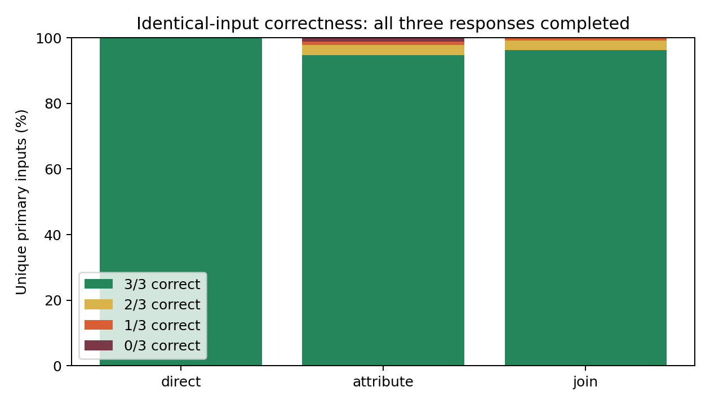
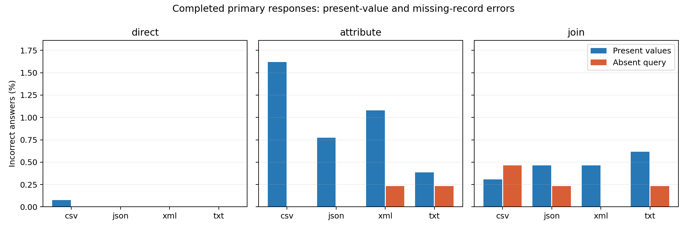
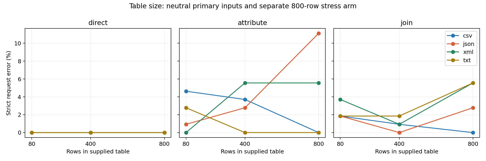
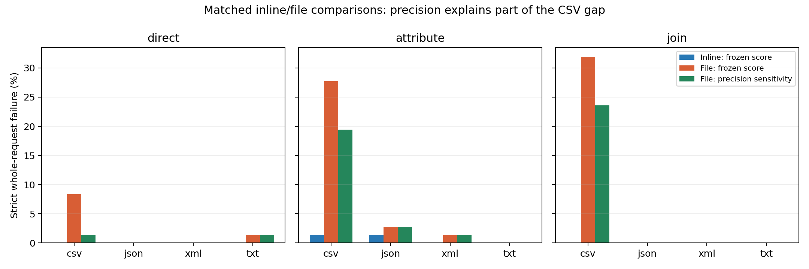

# Conclusions and detailed patterns

The completed study contains **8,376 requests**, including 24 development requests retained from the stopped calibration. It tests three query types, four serialization formats, three identical calls per non-calibration input, and separate controls for file delivery, empirical edits, and longer tables.

## What the main experiment establishes

Across 36 primary sampled blocks, **5,104/5,184 (98.457%)** requests were entirely correct. Present values were correct in **15,474/15,552** answers; absent queries in **5,177/5,184**. Altered present values were correct in **7,739/7,776** answers.

| task | format | n | correct | strict_pct | present_pct | absent_pct |
| --- | --- | --- | --- | --- | --- | --- |
| attribute | csv | 432 | 413 | 95.602 | 98.380 | 100.000 |
| attribute | json | 432 | 422 | 97.685 | 99.228 | 100.000 |
| attribute | txt | 432 | 426 | 98.611 | 99.614 | 99.769 |
| attribute | xml | 432 | 417 | 96.528 | 98.920 | 99.769 |
| direct | csv | 432 | 431 | 99.769 | 99.923 | 100.000 |
| direct | json | 432 | 432 | 100.000 | 100.000 | 100.000 |
| direct | txt | 432 | 432 | 100.000 | 100.000 | 100.000 |
| direct | xml | 432 | 431 | 99.769 | 99.769 | 99.769 |
| join | csv | 432 | 426 | 98.611 | 99.691 | 99.537 |
| join | json | 432 | 425 | 98.380 | 99.537 | 99.769 |
| join | txt | 432 | 423 | 97.917 | 99.383 | 99.769 |
| join | xml | 432 | 426 | 98.611 | 99.537 | 100.000 |

Each row includes all three repeated calls, original/altered tables, both name cues, and both primary sizes. Strict request success here is an end-to-end measure including operational failures. These call totals are not independent block counts.

### Correctness conditional on a completed response

| task | format | completed_requests | correct | present_correct | present_n | absent_correct | absent_n | completed_strict_pct |
| --- | --- | --- | --- | --- | --- | --- | --- | --- |
| attribute | csv | 432 | 413 | 1275 | 1296 | 432 | 432 | 95.602 |
| attribute | json | 432 | 422 | 1286 | 1296 | 432 | 432 | 97.685 |
| attribute | txt | 432 | 426 | 1291 | 1296 | 431 | 432 | 98.611 |
| attribute | xml | 432 | 417 | 1282 | 1296 | 431 | 432 | 96.528 |
| direct | csv | 432 | 431 | 1295 | 1296 | 432 | 432 | 99.769 |
| direct | json | 432 | 432 | 1296 | 1296 | 432 | 432 | 100.000 |
| direct | txt | 432 | 432 | 1296 | 1296 | 432 | 432 | 100.000 |
| direct | xml | 431 | 431 | 1293 | 1293 | 431 | 431 | 100.000 |
| join | csv | 432 | 426 | 1292 | 1296 | 430 | 432 | 98.611 |
| join | json | 432 | 425 | 1290 | 1296 | 431 | 432 | 98.380 |
| join | txt | 432 | 423 | 1288 | 1296 | 431 | 432 | 97.917 |
| join | xml | 432 | 426 | 1290 | 1296 | 432 | 432 | 98.611 |

This sensitivity view excludes operational failures and incomplete outputs from the denominator; the original prespecified end-to-end results remain unchanged. Both views are needed to avoid attributing an API failure to model reasoning.

## Does repetition change the interpretation?

| task | unique_inputs | all_three_correct | mixed_correctness | all_three_wrong | different_parsed_answers | inputs_with_operational_or_incomplete_response |
| --- | --- | --- | --- | --- | --- | --- |
| attribute | 576 | 546 | 23 | 7 | 25 | 0 |
| direct | 576 | 574 | 2 | 0 | 2 | 1 |
| join | 576 | 554 | 21 | 1 | 21 | 0 |

Mixed correctness means an identical input was right on some calls and wrong on others. All-three-wrong inputs identify observed persistent difficulty on those prompts; neither category alone establishes an underlying mechanism. Repetitions estimate reliability conditional on an input, while fresh blocks assess variation across inputs.

For model consistency alone, exclude inputs with any operational/incomplete attempt:

| task | unique_inputs | all_three_correct | mixed_correctness | all_three_wrong | different_parsed_answers |
| --- | --- | --- | --- | --- | --- |
| attribute | 576 | 546 | 23 | 7 | 25 |
| direct | 575 | 574 | 1 | 0 | 1 |
| join | 576 | 554 | 21 | 1 | 21 |

## Which errors matter?

Completed primary responses contain **75 incorrect present-value answers** and **6 incorrect absent-query answers**, involving **22 distinct block/query combinations** across task/format/version/cue/repetition conditions. Missing-record behavior must therefore be considered separately from copying present values.

Across all arms, **0 altered-value answers matched the replaced original value**. A zero count would describe these tested conflicts; it would not prove absence of prior knowledge or training-data exposure.

A separate post-collection diagnostic found **18 numerical errors within 1e-12 of the expected value**. These remain incorrect under the frozen exact-decimal scorer. The diagnostic helps identify possible representation/rounding differences and does not establish their internal cause. Literal-copy rates are recorded separately in literal_copy_accuracy.csv; numerically equivalent strings can pass value scoring while differing in formatting.

## Does a format consistently win?

| format_comparison | difference_pp | interval_95 | adjusted_interval | blocks |
| --- | --- | --- | --- | --- |
| json minus csv | 0.694 | [-0.7716, 2.4691] | [-1.0031, 3.0093] | 36 |
| xml minus csv | 0.309 | [-1.5432, 2.4691] | [-1.9811, 2.9321] | 36 |
| txt minus csv | 0.849 | [-1.0031, 2.9321] | [-1.3889, 3.3951] | 36 |

The prespecified pooled format comparisons do not separate from zero in the adjusted descriptive intervals. The defensible conclusion is no established consistent advantage under these conditions, rather than proven equivalence.

## Actual files versus inline representations

| task | format | inline_n | file_n | inline_strict_pct | file_strict_pct | file_minus_inline_pp |
| --- | --- | --- | --- | --- | --- | --- |
| direct | csv | 72 | 72 | 100.000 | 91.667 | -8.333 |
| direct | json | 72 | 72 | 100.000 | 100.000 | 0.000 |
| direct | xml | 72 | 72 | 100.000 | 100.000 | 0.000 |
| direct | txt | 72 | 72 | 100.000 | 98.611 | -1.389 |
| attribute | csv | 72 | 72 | 98.611 | 72.222 | -26.389 |
| attribute | json | 72 | 72 | 98.611 | 97.222 | -1.389 |
| attribute | xml | 72 | 72 | 100.000 | 98.611 | -1.389 |
| attribute | txt | 72 | 72 | 100.000 | 100.000 | 0.000 |
| join | csv | 72 | 72 | 100.000 | 68.056 | -31.944 |
| join | json | 72 | 72 | 100.000 | 100.000 | 0.000 |
| join | xml | 72 | 72 | 100.000 | 100.000 | 0.000 |
| join | txt | 72 | 72 | 100.000 | 100.000 | 0.000 |

Actual uploads are compared only against their exact inline/neutral counterparts. The file arm has 12 selected primary table blocks, and joins use two labeled files. CSV receives spreadsheet-specific augmentation. A delivery difference therefore includes file parsing and provider preprocessing.

The three file repetitions reuse uploaded file IDs; variability across independent re-uploads is not measured. File delivery and empirical edits are separate arms, so their interaction is not tested.

## Representation length and runtime

| task | format | mean_input_tokens | mean_elapsed_seconds | input_tokens_relative_to_csv |
| --- | --- | --- | --- | --- |
| attribute | csv | 5354.486 | 2.372 | 1.000 |
| attribute | json | 9764.986 | 2.161 | 1.824 |
| attribute | txt | 10519.931 | 2.059 | 1.965 |
| attribute | xml | 14784.931 | 2.136 | 2.761 |
| direct | csv | 5327.681 | 1.568 | 1.000 |
| direct | json | 9738.181 | 1.560 | 1.828 |
| direct | txt | 10493.125 | 1.529 | 1.970 |
| direct | xml | 14758.125 | 1.528 | 2.770 |
| join | csv | 6331.486 | 2.564 | 1.000 |
| join | json | 11461.986 | 2.400 | 1.810 |
| join | txt | 12213.931 | 2.351 | 1.929 |
| join | xml | 17923.931 | 2.375 | 2.831 |

Input-token means first average identical calls within each input, then average inputs. CSV is the within-task reference for the displayed ratio. Latency is descriptive: concurrency changed after the rate-limit stop, and service load was not controlled. File-input token counts include provider processing and are listed separately in representation_overhead.csv.

## Larger tables and plausible edits

The 800-row arm is a separate stress test with only two blocks per source. The empirical-edit arm draws field values from the observed source distribution while avoiding duplicate target values inside the table. Consult analysis.json for matched uniform/empirical contrasts. Neither diagnostic is pooled into the primary format estimate.

## Additional descriptive diagnostics

| stage | task | n_rows | target_third | answers | correct | error_pct |
| --- | --- | --- | --- | --- | --- | --- |
| primary | attribute | 80 | first | 864 | 845 | 2.199 |
| primary | attribute | 80 | last | 864 | 864 | 0.000 |
| primary | attribute | 80 | middle | 864 | 859 | 0.579 |
| primary | attribute | 400 | first | 864 | 855 | 1.042 |
| primary | attribute | 400 | last | 864 | 854 | 1.157 |
| primary | attribute | 400 | middle | 864 | 857 | 0.810 |
| primary | direct | 80 | first | 863 | 863 | 0.000 |
| primary | direct | 80 | last | 863 | 862 | 0.116 |
| primary | direct | 80 | middle | 863 | 863 | 0.000 |
| primary | direct | 400 | first | 864 | 864 | 0.000 |
| primary | direct | 400 | last | 864 | 864 | 0.000 |
| primary | direct | 400 | middle | 864 | 864 | 0.000 |
| primary | join | 80 | first | 864 | 854 | 1.157 |
| primary | join | 80 | last | 864 | 863 | 0.116 |
| primary | join | 80 | middle | 864 | 860 | 0.463 |
| primary | join | 400 | first | 864 | 864 | 0.000 |
| primary | join | 400 | last | 864 | 859 | 0.579 |
| primary | join | 400 | middle | 864 | 860 | 0.463 |

Target thirds refer to the selection table, not to the separately shuffled values table in joins. Position, record identity, and selector difficulty were not independently randomized. These post-collection breakdowns are associations, not an isolated position effect. Selector-width counts are in selector_width_diagnostics.csv and are likewise confounded with source and table construction. Primary scoring and contrasts are unchanged.

## What to tell the professor

We evaluated response consistency with three identical requests per input and variation across fresh sampled tables. We reported single-call accuracy averaged over repetitions, kept missing records separate from present values, and compared formats within matched blocks. We did not average the numerical answers or count repeated calls as new independent tables.

## Limits and protocol history

The initial all-correct development gate stopped at 23/24. Before any main response, a separately versioned protocol adopted a technical-completion/schema gate and retained all development records. Prompts, sampled tables, request order, and scoring were unchanged. This development decision is disclosed and is not presented as untouched preregistration.

The primary has three purposive sources; the extra three sources extend direct lookup only. Tables overlap in source rows, selections require unique targets and valid distractors, and three calls still give imprecise per-prompt reliability estimates. The service model alias may change over time. Runtime versions are recorded and differ from the shared lock. Observed behavior does not establish training-data leakage or a model-internal explanation.

Audit: 8376/8376 records; 300 uploaded files; 0 without confirmed deletion. Raw response-level artifacts remain local and ignored by Git; this report and its aggregate tables are published.

## CSV precision sensitivity (post-collection)

The exact-decimal primary scores remain unchanged. A separate sensitivity allows absolute numeric differences up to 1e-12 while retaining completion, key, string-type, and NOT_FOUND requirements. This was added after inspecting the errors and is descriptive, not a new prespecified endpoint.

| delivery | attempts | completed | exact_correct | tolerant_correct | precision_only_failures |
| --- | --- | --- | --- | --- | --- |
| file | 864 | 862 | 811 | 828 | 17 |
| inline | 864 | 864 | 862 | 862 | 0 |

| delivery | task | format | attempts | completed | exact_correct | tolerant_correct | precision_only_failures |
| --- | --- | --- | --- | --- | --- | --- | --- |
| file | attribute | csv | 72 | 72 | 52 | 58 | 6 |
| file | attribute | json | 72 | 72 | 70 | 70 | 0 |
| file | attribute | txt | 72 | 72 | 72 | 72 | 0 |
| file | attribute | xml | 72 | 71 | 71 | 71 | 0 |
| file | direct | csv | 72 | 72 | 66 | 71 | 5 |
| file | direct | json | 72 | 72 | 72 | 72 | 0 |
| file | direct | txt | 72 | 71 | 71 | 71 | 0 |
| file | direct | xml | 72 | 72 | 72 | 72 | 0 |
| file | join | csv | 72 | 72 | 49 | 55 | 6 |
| file | join | json | 72 | 72 | 72 | 72 | 0 |
| file | join | txt | 72 | 72 | 72 | 72 | 0 |
| file | join | xml | 72 | 72 | 72 | 72 | 0 |
| inline | attribute | csv | 72 | 72 | 71 | 71 | 0 |
| inline | attribute | json | 72 | 72 | 71 | 71 | 0 |
| inline | attribute | txt | 72 | 72 | 72 | 72 | 0 |
| inline | attribute | xml | 72 | 72 | 72 | 72 | 0 |
| inline | direct | csv | 72 | 72 | 72 | 72 | 0 |
| inline | direct | json | 72 | 72 | 72 | 72 | 0 |
| inline | direct | txt | 72 | 72 | 72 | 72 | 0 |
| inline | direct | xml | 72 | 72 | 72 | 72 | 0 |
| inline | join | csv | 72 | 72 | 72 | 72 | 0 |
| inline | join | json | 72 | 72 | 72 | 72 | 0 |
| inline | join | txt | 72 | 72 | 72 | 72 | 0 |
| inline | join | xml | 72 | 72 | 72 | 72 | 0 |

There were 18 near-exact numeric cell errors, all in native CSV uploads. 17 file requests failed solely because of those precision differences. Allowing the small differences in this sensitivity reduces but does not remove the matched file-delivery gap. Other CSV failures primarily returned NOT_FOUND for present records. The observations identify changes in numeric fidelity and retrieval behavior; they do not identify whether the provider parser, augmented representation, or model inference caused them. The failure rate includes the two retained server errors, which are reported separately from model mistakes.

- exact_correct, file minus inline: -5.903 percentage points; descriptive block-bootstrap 95% interval [-8.218, -3.588].
- tolerant_correct, file minus inline: -3.935 percentage points; descriptive block-bootstrap 95% interval [-4.745, -3.125].

